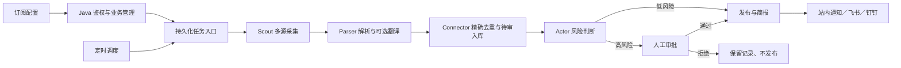

# NexusAI · 订阅驱动的内容情报工作台

NexusAI 将 RSS、公开网页和 JSON API 的内容汇集到个人工作台，经解析、关键词过滤、去重和风险审核后提供阅读、简报、站内通知，以及飞书／钉钉机器人推送。

当前实现采用 React + Java + Python 架构。旧版全景 PDF、面试材料和早期技术文档包含尚未启用的规划；实际启动和验收请以本文件及 [运行与验收说明](docs/RUNBOOK.md) 为准。

## 主链路



- 前端：中文科技感工作台、深浅主题、订阅编辑、内容分页搜索、任务监控、审批和推送记录。
- 数据源中心：217 个中英文 RSS/Atom 频道，分类搜索、健康检测、文章预览、批量加入订阅和 OPML 导出。实测结果及维护方法见 [数据源说明](docs/SOURCES.md)。
- 质量与试采：来源自动巡检、失败退避和历史成功率；正文质量标记、验证页/导航页拦截；订阅保存前可只读试采，查看关键词匹配与可读样本。
- 自动来源：新建订阅填写关注主题即可，系统从来源库匹配健康来源；支持中文优先、排除系统来源、保留额外来源，采集前自动刷新。
- Java：JWT 登录注册、订阅 CRUD、用户数据隔离、统计、通知和管理员审批。
- Python：LangGraph 五节点流程、持久化任务、异步采集、正文清洗、原文与译文分离、机器人签名投递。
- MySQL：业务数据、任务状态、审批上下文和投递记录。Redis 可缓存节点状态。
- MCP 为可选采集传输。旧版 RocketMQ、向量库代码保留为扩展代码，未纳入本次基础运行验收。

## 本机启动

已验证环境：Windows、Node 24、Python 3.12、Java 24（编译目标 Java 17）、Maven 3.9。本机 MySQL 5.7 兼容验证通过；Docker 配置使用 MySQL 8。

### 1. 配置依赖

```powershell
Copy-Item .env.example nexus-python/.env
# 编辑 nexus-python/.env，填写本地 DB_PASSWORD、JWT_SECRET。
python -m pip install -r nexus-python/requirements.txt
npm.cmd --prefix frontend ci
```

已有 `nexus-python/.env` 时保留现有配置，不要覆盖模型密钥。

### 2. 启动数据库与 Redis

本机已安装相应二进制时：

```powershell
powershell -ExecutionPolicy Bypass -File scripts/start-local-infra.ps1
```

脚本默认使用 `D:\MySQL\mysql-5.7.37-winx64\bin` 和 `D:\Redis`，可用 `-MySqlBin`、`-RedisBin` 指定其他位置。只使用项目 `.runtime` 数据目录；若端口已有服务，则复用已运行服务。新建本地数据库的密码来自当前配置。

也可以使用 Docker（不要与本地服务同时占用同一端口）：

```powershell
docker compose --env-file nexus-python/.env up -d mysql redis
```

### 3. 初始化并启动应用

```powershell
python scripts/dev.py start --build
```

打开 [http://127.0.0.1:5173](http://127.0.0.1:5173)。首次使用可直接注册普通账号。需要管理员审批时，由本机操作者交互式初始化管理员：

```powershell
python scripts/create_admin.py --username admin
```

初始化脚本要求输入并确认密码，不提供默认管理员密码，也不把密码写入文件。

```powershell
python scripts/dev.py status
python scripts/dev.py stop
# 修改代码后重新打包时先停服务，避免 Windows JAR 文件锁：
python scripts/dev.py start --build
```

日志保存在 `.runtime/python.log`、`java.log`、`gateway.log`、`frontend.log`。停止应用不会删除数据库，也不会停止 MySQL 或 Redis。

## 开始订阅

1. 点击“新建订阅”，手动填写 RSS／网页／JSON API 地址，或从内置目录推荐中选择并预览 RSS。
2. 关注关键词留空表示采集全部条目；填写后按标题和摘要进行不区分大小写的包含匹配。
3. 设置采集间隔（15 分钟至 7 天），保存后可手动采集。调度器每分钟检查到期订阅，最多同时运行 3 个采集任务。
4. 在任务监控查看五个节点、错误和简报。在内容中心查看已发布的原文与可选译文。
5. 高风险内容进入管理员审批；通过后才发布并推送，拒绝后不公开。

同一订阅同时触发时复用正在运行的任务。已发布或已拒绝的重复条目不会再次入库；没有新增内容时不重复推送。

## 模型和推送

- 未配置模型密钥也能采集、解析、去重、阅读和发送基础简报。
- 填写 `LLM_API_KEY`、`LLM_BASE_URL`、`LLM_MODEL_NAME` 后，可手动翻译／摘要，或在订阅中勾选自动 AI 处理。
- 自动翻译每次最多处理 10 条，模型调用最多并发 2 个；模型失败会保留原文。
- 在“推送设置”添加飞书或钉钉机器人的 Webhook，开启签名时填写对应密钥。可手动测试连接，投递失败会记录原因和尝试次数，可重试。
- 本次推送验收使用本地模拟接收器，没有向真实群聊发送消息；真实群联调需要填写你自己的机器人配置。

## 验证

```powershell
python -m pip install -r nexus-python/requirements-dev.txt
python -m pytest
npm.cmd --prefix frontend run build
```

完整业务回归与浏览器检查见 [运行与验收说明](docs/RUNBOOK.md)。
